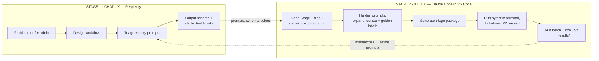
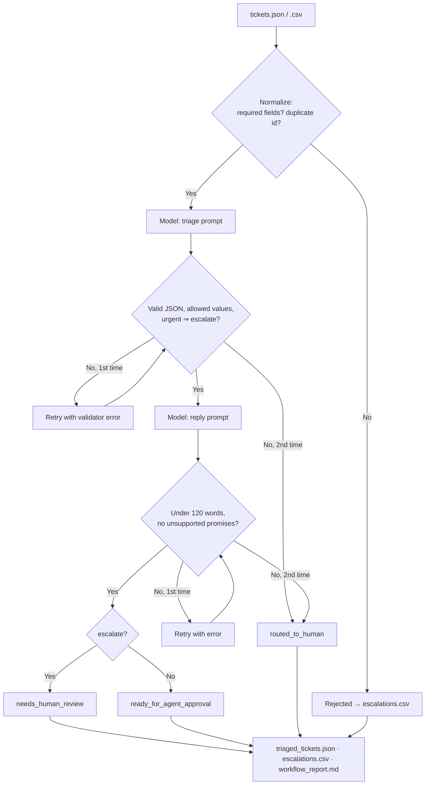

# AI-Powered Customer Support Ticket Triage
### A two-stage AI workflow: Perplexity (Chat) → Claude Code (IDE)

The workflow takes raw support tickets and produces a structured record for each one: category, priority, sentiment, escalation flag, a draft reply, and a validation result. Batch-level outputs for the support team are generated alongside. A human approves every outbound reply, and high-risk tickets always go to a person.

---

## 1. Problem

Support agents spend much of their time on repetitive first-pass work for every ticket: reading it, assigning a category, judging urgency, spotting the dangerous ones, and writing a first reply. That work is slow and inconsistent. When it's rushed, a security breach or legal threat can sit in the queue behind password questions.

This workflow automates that first pass. It also enforces safety rules in code, so they don't depend on a model always following its prompt.

| | |
|---|---|
| **Input** | `tickets.json` or `tickets.csv` (required: `ticket_id`, `subject`, `message`) |
| **Output** | `triaged_tickets.json`, `escalations.csv`, `workflow_report.md`, `evaluation.md` |

---

## 2. How the UX types are chained

The workflow uses two different AI tools in two different UX types. The files the first tool produces are the input to the second.

| Stage | UX type | Tool used | Receives | Produces |
|---|---|---|---|---|
| 1. Design | **Chat** | **Perplexity** | Problem brief + rubric | Workflow design, triage and reply prompts, output schema, starter test tickets, first-draft pipeline outline |
| 2. Build, test & run | **IDE** | **Claude Code** in VS Code | Stage 1 files + `docs/stage2_ide_prompt.md` | Hardened prompts, 18-ticket test set + golden labels, `triage/` package, 22 passing tests, `results/` from a full run |
| Loop | Chat | Perplexity | Mismatches in `results/evaluation.md` | Refined prompts |

**Why these two tools.**

- **Perplexity** suits the design stage. It is a conversational, search-backed chat tool, which helps when researching triage practice and iterating on wording.
- **Claude Code** suits the build stage. It works inside the editor on the actual repository: it creates files, runs `pytest` in the integrated terminal, reads failures and fixes them.

The two tools are not tied together. Any chat AI can replace Perplexity, and any IDE AI (Copilot, Cursor, JetBrains AI) can replace Claude Code, because each handoff is plain files plus a plain-text prompt.

The exact prompts used are in `docs/stage1_chat_prompts.md` (Perplexity) and `docs/stage2_ide_prompt.md` (Claude Code).

## 3. Diagrams

### 3.1 Workflow across UX types



### 3.2 What happens to each ticket at run time



(The diagrams are also saved as `docs/*.mermaid`.)

---

## 4. Quick start

```bash
pip install -r requirements.txt
python -m pytest -q                                   # 22 passed
python -m triage run --input data/tickets.json --output results --provider mock
python -m triage evaluate
```

The `mock` provider runs completely offline, with no API key. To use a real model, change one flag:

```bash
export ANTHROPIC_API_KEY=...   && python -m triage run --input data/tickets.json --provider anthropic
export OPENAI_API_KEY=...      && python -m triage run --input data/tickets.json --provider openai
ollama pull llama3.1           && python -m triage run --input data/tickets.json --provider ollama   # free, local
```

To try the retry path: `TRIAGE_MOCK_FAIL_FIRST=TCK-1005 python -m triage run ...`

---

## 5. Step-by-step notes

### Stage 1: Perplexity (Chat UX): design

1. Give Perplexity the problem and the rubric, and ask it to design a ticket-triage workflow. It produced:
   - the five-stage design (normalize → classify → draft → validate → report);
   - the classification and reply prompts;
   - the JSON output format;
   - the operating rules (urgent ⇒ escalate; refunds, closures, legal and security tickets need a human);
   - two starter tickets (TCK-1001, TCK-1002);
   - a first-draft Python outline.
2. Save those outputs into the repo as `prompts/`, `schema/` and `data/tickets.json`. This is the handoff: commit and tag it `stage1-perplexity-output`.

### Stage 2: Claude Code (IDE UX): build, test, run

3. Open the repo in VS Code with the Claude Code extension and paste `docs/stage2_ide_prompt.md`. Working from Perplexity's files, Claude Code:
   - **hardens the prompts:** ticket text is wrapped in `<ticket>` tags and treated as data (prompt-injection protection), replies are written in the customer's language, and a retry prompt is added;
   - **completes the schema:** it adds strict enums and `additionalProperties: false`, and makes the schema the single source of truth the validator reads;
   - **expands the test set from 2 to 18 tickets:** high-risk cases (account takeover, outage, data loss, GDPR legal threat, violent threat, card fraud), tricky cases (a French ticket and a prompt-injection attempt), and two invalid records. It labels the 16 valid ones and drafts replies as `golden_triage_results.json`, which a human reviews;
   - **builds the `triage` package** around a single `ChatProvider.complete()` interface, so `pipeline.py` has no vendor code. It also adds a mock provider so everything runs offline;
   - **closes the gaps in the first draft:** the Perplexity outline's `call_chat_ai()` raised `NotImplementedError`, and its retry was described but not written. Both now work.
4. Claude Code runs `pytest` in VS Code's terminal and fixes failures. One real iteration happened here: the mock read the schema example `"ticket_id": "string"` instead of the ticket's id, which caused 8 failures. After the fix, 22/22 tests pass.
5. Claude Code runs the batch and evaluation in the same terminal:
   ```bash
   python -m triage run --input data/tickets.json --output results --provider mock
   python -m triage evaluate
   ```
   Repeat with a real provider (for example `--provider ollama --output results-ollama`) to get a genuine accuracy figure.
6. Take any mismatches in `evaluation.md` back to Perplexity, refine the prompts, and rerun.

### Operating rules (enforced in code, not just in prompts)

- Urgent tickets must be escalated; the validator rejects output that breaks this.
- Refunds, account closures, legal issues, security incidents and threats are escalated for human review.
- Replies must be non-empty, under 120 words, and free of unsupported promises.
- Invalid AI output gets one retry with the error message appended. A second failure sends the ticket to a human.
- A bad ticket or a provider outage never stops the batch.
- Replies are drafts. Nothing is sent automatically.

---

## 6. Test results

### Automated tests (`python -m pytest -q`): 22 passed

| Area | What is checked |
|---|---|
| End-to-end | 18 in → 16 processed, 2 rejected, 8 escalated; all 3 output files created; CSV has 10 rows |
| Business rules | urgent ⇒ escalate for every result; every reply 1–119 words; status matches escalate flag |
| Safety | Prompt-injection ticket (TCK-1016) stays urgent and escalated |
| Retry | Invalid `"priority": "critical"` → retried with the validator error in the prompt → recovers |
| Human routing | Two invalid responses → `routed_to_human`; the rest of the batch completes |
| Resilience | Provider raising `ConnectionError` → tickets routed to human, no crash |
| Inputs | Empty list → empty report; CSV input; duplicate IDs rejected; unknown tickets handled |
| Validator | Bad enum, bad category, urgent without escalate, non-boolean escalate, ID mismatch, fenced JSON, extra keys, empty reply, too-long reply, refund/timeline promises |
| Evaluation | Agreement report computed against golden labels |

### End-to-end run (`results/`, mock provider, one injected bad response)

| Metric | Value |
|---|---|
| Tickets in input | 18 |
| Processed | 16 |
| Rejected at normalization | 2 (TCK-1017 missing message, TCK-1018 whitespace-only) |
| Ready for agent approval | 8 |
| Escalated for human review | 8 |
| Routed to human after failed validation | 0 |
| Retries used | 1 (TCK-1005, recovered) |
| Categories | billing 5 · account_access 3 · technical 3 · product_question 2 · complaint 2 · other 1 |
| Priorities | urgent 5 · high 4 · medium 2 · low 5 |

The mock provider replays the golden labels, so its 100% agreement only shows that the pipeline is wired correctly. It says nothing about model accuracy. Accuracy figures come from runs against real providers (step 5), recorded in `results/evaluation.md`.

---

## 7. Adaptability

| To change… | Do this | Code changes |
|---|---|---|
| Model or vendor | `--provider anthropic \| openai \| ollama` + env var | none |
| Any OpenAI-compatible API (Gemini, Groq, LM Studio, vLLM) | set `OPENAI_BASE_URL` and `OPENAI_MODEL` | none |
| A brand-new vendor | add one ~20-line class implementing `complete()` | one file |
| Categories / priorities | edit `schema/triage_schema.json` and the prompt text | none (the validator reads the schema) |
| Wording or tone | edit `prompts/*.txt` | none |
| Input format | JSON and CSV are both supported | none |
| Tool used at either stage | any chat AI for Perplexity; any IDE AI for Claude Code; the stage prompts are plain text | none |

Other properties that keep the workflow portable:

- The core needs only the Python standard library. Vendor SDKs are optional and imported lazily.
- The pipeline does not depend on vendor-specific structured-output features. Strict validation and a retry make any model that returns text usable.

---

## 8. Efficiency

| Without the workflow | With the workflow |
|---|---|
| Read every ticket, classify, prioritise, write a reply from scratch | Review a pre-filled record and approve or edit the draft |
| High-risk tickets found whenever someone reaches them | High-risk tickets listed at the top of `escalations.csv` from the moment the batch runs |
| Counts and trends compiled by hand | `workflow_report.md` produced automatically |
| Workflow changes require re-briefing staff | Edit a prompt or the schema file |

**Estimate for the test batch:** about 5 min per ticket by hand versus 1.5 min to review an AI-prepared record. Escalated tickets are counted conservatively at the full 5 minutes.

| | Minutes |
|---|---|
| Fully manual (16 tickets) | 80 |
| With workflow | 52 |
| Saving | 28 min (35%) |

At 50 tickets with a typical 20% escalation rate, the same assumptions give a 56% saving. Change the assumptions with `--manual-minutes` and `--review-minutes` to match measured times.

Building the workflow itself was also faster because of the chaining. Perplexity produced the design, prompts and schema in one conversation. Claude Code turned them into tested, running code from a single spec, without manual copy-paste between files.

---

## 9. Repository layout

```
ai-ticket-triage/
├── README.md                          ← this document
├── requirements.txt
├── prompts/                           ← Stage 1 (Perplexity), hardened in Stage 2
├── schema/triage_schema.json          ← Stage 1 (Perplexity), completed in Stage 2
├── data/tickets.json                  ← Stage 1 starter tickets, expanded to 18 in Stage 2
├── data/golden_triage_results.json    ← Stage 2 (Claude Code), human-reviewed
├── triage/                            ← Stage 2 (Claude Code): the working pipeline
│   └── providers/                     ← mock, OpenAI, Anthropic, Ollama
├── tests/test_pipeline.py             ← Stage 2: 22 tests
├── results/                           ← Stage 2: output of the recorded run
└── docs/
    ├── workflow_diagram.mermaid       ← Perplexity → Claude Code chain
    ├── runtime_pipeline.mermaid       ← per-ticket flow
    ├── stage1_perplexity_output.md    ← Perplexity's original answer (Stage 1 evidence)
    ├── stage1_chat_prompts.md         ← prompts used in Perplexity
    ├── stage2_ide_prompt.md           ← prompt used in Claude Code
    └── screenshots/                   ← one per stage
```

Git history: Perplexity's output is tagged `stage1-perplexity-output`. Run `git diff stage1-perplexity-output stage2-claude-output` to see exactly what Claude Code added.

## 10. Limitations and next steps

- Reported accuracy depends on the provider. Run the batch against at least one real model and record the result in `evaluation.md`.
- The golden set has 16 tickets. Grow it with real (anonymised) tickets that were misclassified.
- The unsupported-promise check is a phrase list. A second model pass could review replies against company policy.
- Next steps:
  - Add a CLI AI stage (e.g. Claude Code in the terminal or Gemini CLI) to run batches on a schedule and write findings automatically.
  - Push `escalations.csv` straight into the helpdesk (Zendesk, Freshdesk, Jira) through its API.
