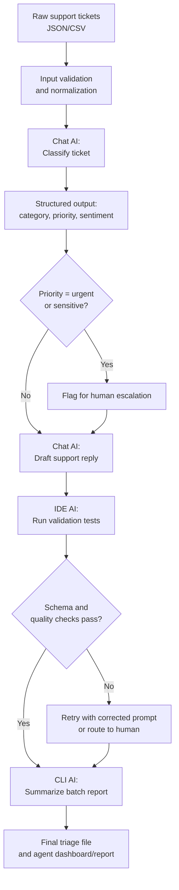

# Stage 1 output: Perplexity's original submission

> Recorded exactly as Perplexity (Chat UX) produced it, in response to the project rubric. This is the input that was handed to Stage 2 (Claude Code). Compare it with the rest of the repo to see what the second AI changed.

---

AI workflow project: **AI-Powered Customer Support Ticket Triage**. It takes raw support tickets, classifies and prioritizes them, drafts a response, and produces a structured handoff for an agent. It is designed to run end-to-end with interchangeable AI tools and models.

## Problem and outcome

Support teams spend substantial time manually reading tickets, assigning categories, deciding urgency, and writing first replies. This workflow automates the repetitive first-pass work while keeping a human in control of final approval and escalation.

- **Input:** Raw customer support tickets in JSON or CSV.
- **Output:** A structured ticket record containing category, priority, sentiment, draft reply, escalation flag, and quality-check result.

## Workflow diagram



## Required tools and datasets

| Requirement | Example implementation | Why it fits |
|---|---|---|
| Chat-based AI platform | Perplexity, ChatGPT, Claude, or any chat UI | Used for prompt design, classification, drafting, and iteration |
| IDE with AI integration | VS Code + GitHub Copilot, Cursor, or JetBrains AI | Used to implement, debug, and test the workflow |
| CLI-based AI interface | GitHub Copilot CLI, OpenAI CLI, Claude Code, or a local model CLI | Used to run batch processing and generate reports |
| Test data/content | 10–20 support tickets covering billing, login, bugs, refunds, and abuse | Enables repeatable end-to-end testing |

## Workflow stages

### Stage 1: Collect and normalize tickets
Create `tickets.json` with fields such as `ticket_id`, `customer_name`, `subject`, `message`, and `channel` (two starter tickets: TCK-1001 login issue, TCK-1002 duplicate charge). The normalization step removes empty records, trims whitespace, validates required fields, and converts all tickets into the same JSON structure.

### Stage 2: Classify and prioritize
Send each ticket to the chat AI with a strict output schema (see `prompts/triage_prompt.txt` at tag `stage1-perplexity-output`).

### Stage 3: Draft a response
For non-escalated tickets, ask the chat AI to generate a short, empathetic first response (see `prompts/reply_prompt.txt` at tag `stage1-perplexity-output`). Escalated tickets still receive a holding response, but are marked for human review before sending.

### Stage 4: Validate outputs
The IDE AI helps implement automated checks:
- Required fields exist.
- `category`, `priority`, and `sentiment` contain only allowed values.
- `escalate=true` whenever priority is urgent.
- Draft reply is non-empty and below the word limit.
- No unsupported promises such as "guaranteed refund" unless policy allows it.

If validation fails, the workflow retries once with an error message appended to the prompt. If it fails again, it routes the ticket to a human.

### Stage 5: Run batch and report
The CLI AI runs the workflow across all tickets and creates `triaged_tickets.json`, `escalations.csv`, and `workflow_report.md`.

```bash
ai-workflow run --input tickets.json --output ./results --model any-supported-model
```

## Minimal implementation (as produced)

```python
import json
from pathlib import Path
from pydantic import BaseModel, Field, ValidationError

class TriageResult(BaseModel):
    ticket_id: str
    category: str
    priority: str
    sentiment: str
    escalate: bool
    reason: str

ALLOWED = {
    "category": {"billing", "technical", "account_access", "product_question", "complaint", "other"},
    "priority": {"low", "medium", "high", "urgent"},
    "sentiment": {"positive", "neutral", "negative"}
}

def call_chat_ai(prompt: str, schema: dict) -> dict:
    """
    Replace with your preferred AI provider.
    The provider should support JSON/structured output.
    """
    raise NotImplementedError("Connect your chosen chat AI API here")

def normalize_ticket(raw: dict) -> dict:
    required = ["ticket_id", "subject", "message"]
    for field in required:
        if not raw.get(field):
            raise ValueError(f"Missing required field: {field}")
    return {
        "ticket_id": str(raw["ticket_id"]).strip(),
        "customer_name": str(raw.get("customer_name", "Customer")).strip(),
        "subject": str(raw["subject"]).strip(),
        "message": str(raw["message"]).strip(),
        "channel": str(raw.get("channel", "unknown")).strip()
    }

def triage_ticket(ticket: dict) -> dict:
    prompt = f"""
    Classify this customer support ticket.
    Return JSON with: ticket_id, category, priority, sentiment, escalate, reason.
    Allowed categories: billing, technical, account_access, product_question, complaint, other.
    Allowed priorities: low, medium, high, urgent.
    Allowed sentiment: positive, neutral, negative.
    Ticket:
    {json.dumps(ticket)}
    """
    result = call_chat_ai(prompt, TriageResult.model_json_schema())
    validate_triage(result)
    return result

def validate_triage(result: dict) -> None:
    try:
        TriageResult(**result)
    except ValidationError as error:
        raise ValueError(f"Invalid AI output: {error}")
    for field, values in ALLOWED.items():
        if result[field] not in values:
            raise ValueError(f"Invalid {field}: {result[field]}")
    if result["priority"] == "urgent" and not result["escalate"]:
        raise ValueError("Urgent tickets must be escalated")

def draft_reply(ticket: dict, triage: dict) -> str:
    prompt = f"""
    Write a concise customer-support reply.
    Ticket: {json.dumps(ticket)}
    Triage: {json.dumps(triage)}
    Rules:
    - Acknowledge the issue.
    - Explain the next step.
    - Do not make unsupported promises.
    - Maximum 120 words.
    """
    return call_chat_ai(prompt, {"type": "object", "properties": {"reply": {"type": "string"}}})["reply"]

def run_workflow(input_path: str, output_path: str):
    tickets = json.loads(Path(input_path).read_text())
    results = []
    for raw in tickets:
        ticket = normalize_ticket(raw)
        triage = triage_ticket(ticket)
        reply = draft_reply(ticket, triage)
        results.append({
            **ticket,
            "triage": triage,
            "draft_reply": reply,
            "status": "needs_human_review" if triage["escalate"] else "ready_for_agent_approval"
        })
    Path(output_path).write_text(json.dumps(results, indent=2))
    return results
```

## Test plan

| Test case | Input example | Expected result |
|---|---|---|
| Login issue | "Cannot log in after password reset" | account_access, at least high priority |
| Duplicate charge | "I was charged twice" | billing, refund routed to human approval |
| General question | "How do I export my data?" | product_question, low or medium priority |
| Security issue | "Someone accessed my account" | urgent, escalate=true |
| Missing field | Ticket without message | Rejected during normalization |
| Invalid AI output | Model returns "priority": "critical" | Validation fails and retry/human routing occurs |
| Empty dataset | `[]` | Workflow completes and creates an empty report |

## Operating rules

- Urgent tickets must be escalated.
- Refunds, account closures, legal issues, and security incidents require human approval.
- AI-generated replies are drafts, not automatically sent messages.
- If structured validation fails twice, the ticket is routed to a human.

## Adaptability
To change AI providers, replace only `call_chat_ai()`. To change business rules, update the allowed values, escalation rules, and validation checks. To process CSV, add a CSV loader.

## Efficiency justification
For a batch of 50 tickets, this can reduce initial handling from roughly 50 full manual triage sessions to reviewing 50 concise AI-prepared records, with only high-risk or ambiguous tickets requiring deeper investigation.

---

## Gaps identified when handing off to Stage 2

| Gap in Perplexity's version | Resolved in Stage 2 (Claude Code) |
|---|---|
| `call_chat_ai()` raises `NotImplementedError`, so nothing runs | `ChatProvider` interface + mock, Anthropic, OpenAI, Ollama adapters |
| Retry described but not implemented | `TriagePipeline._ask()` retries with the validator error appended |
| One bad ticket crashes the whole batch | Errors are caught per ticket; the batch always completes |
| `escalations.csv` and `workflow_report.md` described but not generated | `triage/report.py` |
| CSV input mentioned but not supported | `normalize.load_tickets()` handles JSON and CSV |
| Only 2 test tickets, no expected answers | 18 tickets + human-reviewed golden labels + 22 automated tests |
| Ticket text could inject instructions into the prompt | `<ticket>` tags, treated as data only; injection test case |
| `ai-workflow run` command does not exist | `python -m triage run` / `python -m triage evaluate` |
